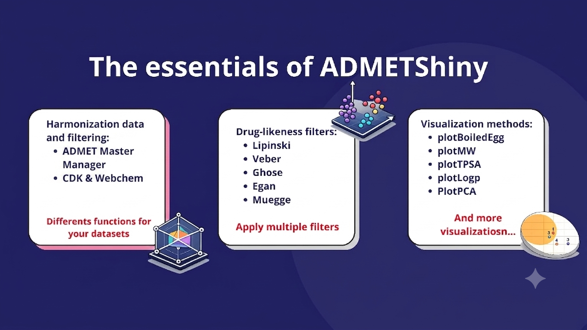
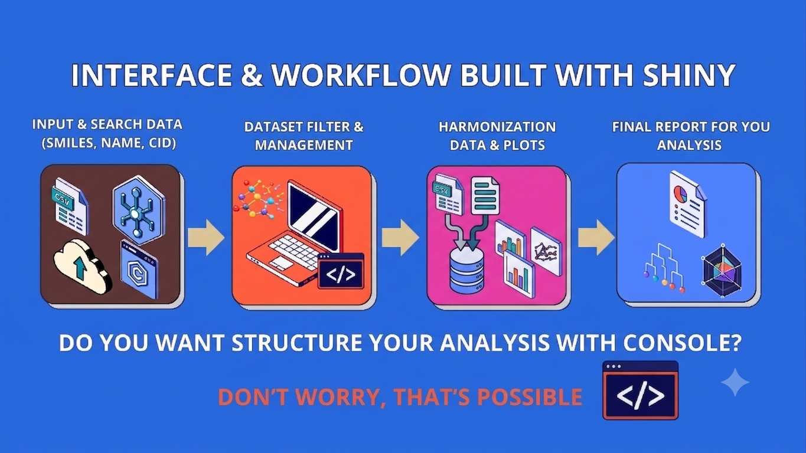
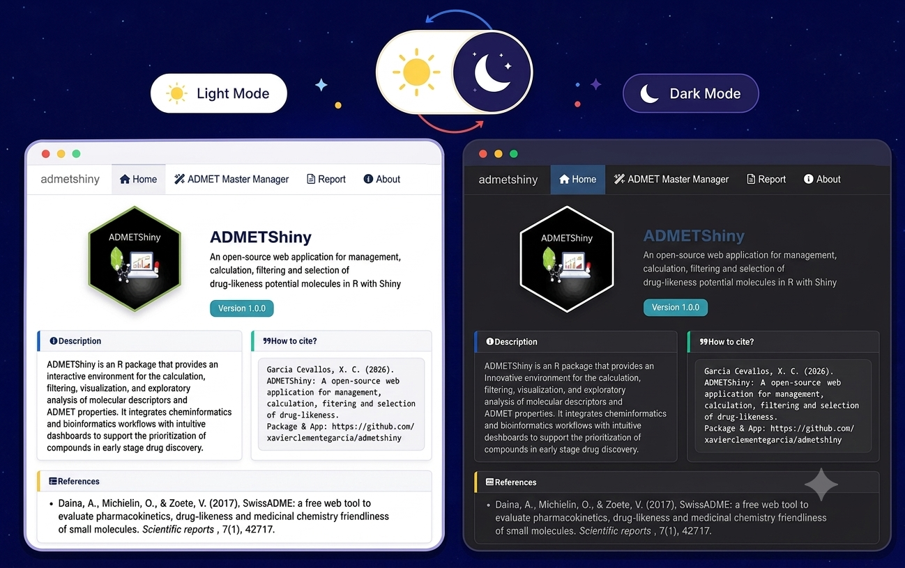
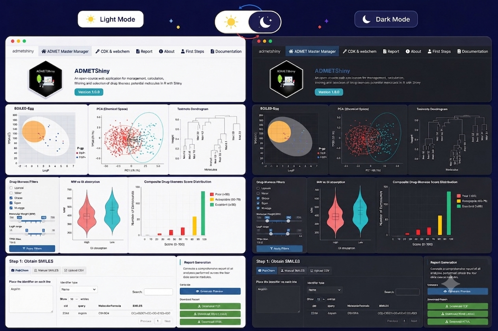

------------------------------------------------------------------------

## ⚙️ Principal Functions of ADMETShiny in R

With **ADMETShiny**, say goodbye to manual ADMET analysis spread across multiple web servers. Manage all your **physicochemical profiles in a single place**.

{fig-align="center"}

Once your analysis is complete, you can generate a **single consolidated report** summarizing the main characteristics of each model.

::: callout-tip
## 🔒 No external websites needed

Don't want to submit your compounds to external websites? Don't worry. ADMETShiny includes a **local web server** built with the **rCDK** R package and the **Java SE Development Kit (JDK)**, so your profiles can be estimated entirely on your own machine.
:::

------------------------------------------------------------------------

## 🌐 One for Open Source, and Open Source for One

ADMETShiny accepts **input data from multiple sources**:

| Input method | Details |
|--------------|---------|
| 📄 **Datasets** | Upload files in `.csv` format |
| 🔎 **PubChem search** | By **CID**, **common name**, **InChIKey**, or **CAS** number |

### 🧪 Calculate drug-likeness properties with CDK and webchem

Dataset management and filters can be applied to the calculated **molecular descriptors**, producing clear and reproducible reports with minimal effort.

{fig-align="center"}

### 💻 Prefer the console? Build reproducible scripts

Everything available in the graphical interface can also be run from the R console, allowing you to develop **simple, reproducible scripts** and generate your reports programmatically.

------------------------------------------------------------------------

## 👥 The Shiny App for Coders and Non-Coders

::: callout-note
## Built for everyone

ADMETShiny offers an **intuitive graphical interface** that makes advanced cheminformatics analyses accessible without programming experience, while remaining fully integrated with the R ecosystem for users who require **reproducible, customizable, and extensible** workflows.
:::

{fig-align="center"}

------------------------------------------------------------------------

## 🧠 Knowledge Structure Analysis

ADMETShiny provides a comprehensive collection of **interactive modules** that streamline the early stages of drug discovery in a single, user-friendly environment:

- 🔬 **Molecular retrieval**
- 🧮 **Descriptor calculation**
- 🧬 **ADMET prediction**
- 🌌 **Chemical space exploration**
- 🔗 **Structural similarity analysis**
- 📑 **Automated reporting**

{fig-align="center"}

::: callout-important
## In summary

ADMETShiny combines **data retrieval, descriptor calculation, predictive modeling, interactive visualization, molecular prioritization, and automated reporting** in a unified open-source platform, designed to accelerate computational drug discovery and medicinal chemistry research.
:::