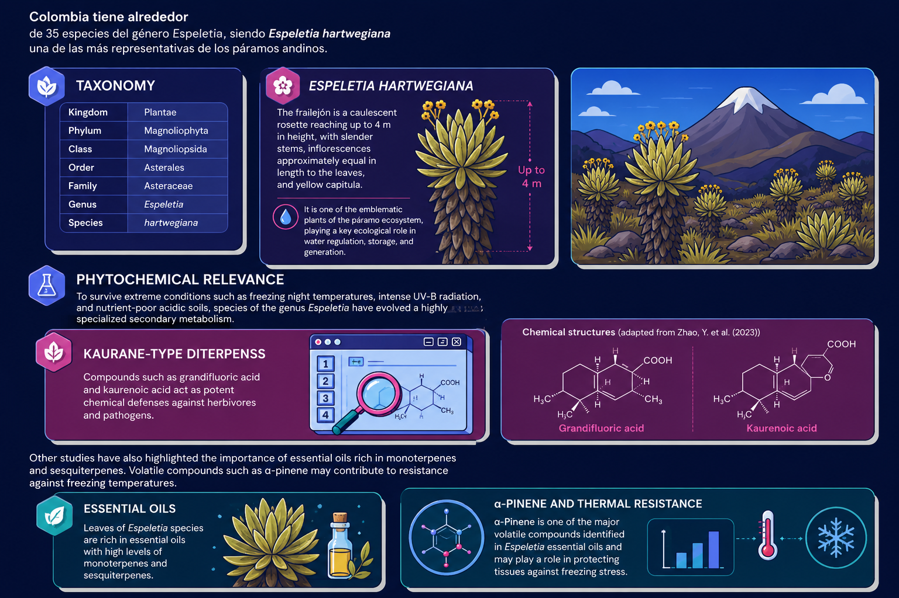
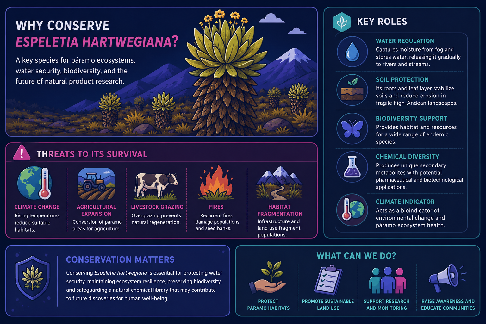

::: {style="text-align: center;"}
# 🌿 The Flagship Species

## ***Espeletia hartwegiana***

*The guardian of the Colombian páramo*
:::

------------------------------------------------------------------------

## 🌱 Species Overview

The **frailejón** is a caulescent rosette reaching up to **4 m** in height, with slender stems, inflorescences approximately equal in length to the leaves, and yellow capitula.

::: callout-note
## Ecological significance

It is one of the emblematic plants of the Colombian páramo ecosystem, playing a key role in **water regulation, storage, and generation**.
:::

{fig-align="center"}

------------------------------------------------------------------------

## 🦋 A Keystone of High-Andean Biodiversity

Beyond its ecological function, *E. hartwegiana* supports a unique assemblage of **microorganisms, insects, birds, and other high-Andean organisms** that depend on páramo habitats.

The species is also an important reservoir of **specialized secondary metabolites** with promising pharmacological and biotechnological potential.

------------------------------------------------------------------------

## ⚠️ Conservation Threats

Natural populations throughout the northern Andes are under increasing pressure from:

- 🌡️ **Climate change**
- 🚜 **Agricultural expansion**
- 🐄 **Livestock grazing**
- 🔥 **Recurrent fires**
- 🧩 **Habitat fragmentation**

::: callout-warning
## Upward habitat shift

Rising temperatures are expected to reduce suitable páramo habitats, forcing populations to migrate to higher elevations where available habitat becomes increasingly limited.
:::

{fig-align="center"}

------------------------------------------------------------------------

## 💧 Why Conservation Matters

The conservation of *Espeletia hartwegiana* is essential not only for preserving one of the world's most biodiverse mountain ecosystems, but also for safeguarding:

:::::: {layout-ncol="3"}
::: callout-tip
## 💧 Water security
:::

::: callout-tip
## 🌎 Ecological resilience
:::

::: callout-tip
## 🧬 Chemical diversity
:::
::::::

Together, these values support **future discoveries in natural product research and drug development**.

{fig-align="center"}
