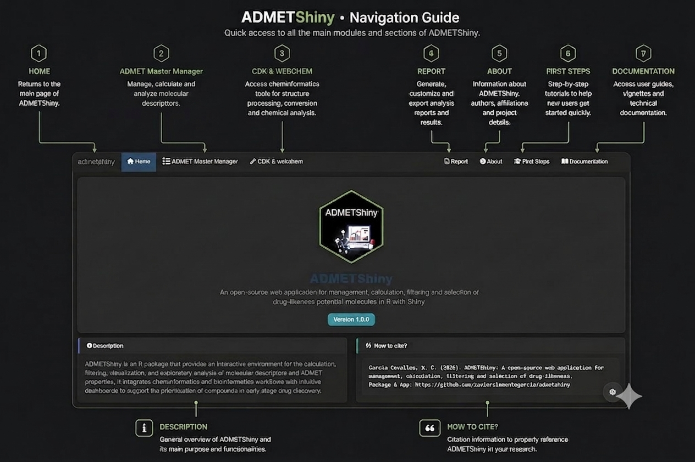
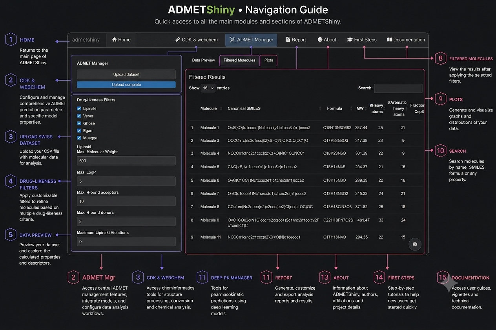
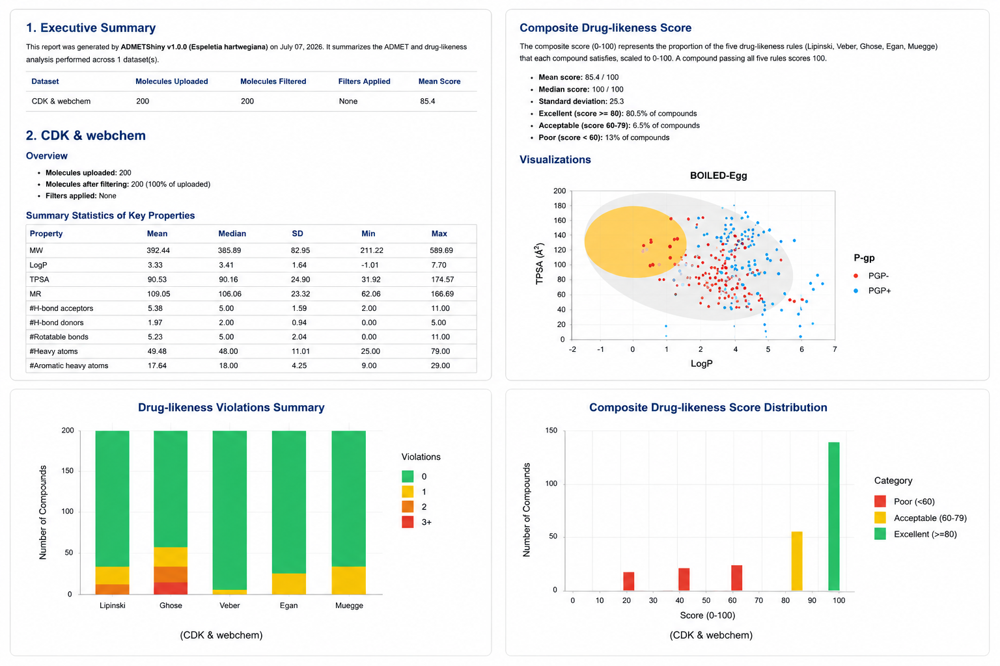

------------------------------------------------------------------------

## 🖥️ The User Interface

**ADMETShiny (Version 1.0.0)** is an open-source R Shiny web application designed for the management, calculation, filtering, and selection of drug-like molecules in early-stage drug discovery.

{fig-align="center"}

### Navigation bar

The top horizontal bar is divided into **seven numbered modules**, each marked with a green hex icon:

| \# | Module | Purpose |
|:--:|--------|---------|
| 1 | **Home** | Returns to the main landing page |
| 2 | **ADMET Master Manager** | Calculates and analyzes molecular properties |
| 3 | **CDK & webchem** | Cheminformatics tools for structure processing and chemical analysis |
| 4 | **Report** | Customizes and exports analysis results |
| 5 | **About** | Project and author information |
| 6 | **First Steps** | Step-by-step tutorials for new users |
| 7 | **Documentation** | Technical guides and vignettes |

### Landing page panels

Below the navigation bar, the dashboard is split into two sections:

::: {layout-ncol="2"}
::: callout-note
## 📝 Description

Summarizes the app's integration of bioinformatics and cheminformatics workflows for molecular descriptor visualization.
:::

::: callout-tip
## 📖 How to cite?

Provides the formal 2026 academic citation and the GitHub repository link.
:::
:::

------------------------------------------------------------------------

## 🧪 The Dataset Example

The **Drug-likeness Filters** section lets users apply customizable filters based on popular medicinal chemistry criteria:

- ✅ **Lipinski**
- ✅ **Veber**
- ✅ **Ghose**
- ✅ **Egan**
- ✅ **Muegge**

Adjustable thresholds are available for maximum **molecular weight**, **logP**, **hydrogen bond acceptors/donors**, and **maximum Lipinski violations**.

{fig-align="center"}

### Filtered results

The central area displays the **Filtered Results** table under the **Filtered Molecules** tab **(6)**, giving a structured overview of the compounds that meet the selected criteria. This interactive data grid shows key molecular descriptors:

- Molecule ID
- Canonical SMILES
- Chemical formula
- Molecular weight (MW)
- Number of heavy atoms
- Number of aromatic heavy atoms

::: callout-tip
## 🔍 Quick search

Use the **Search** bar **(8)** at the top right of the table to filter molecules by name, SMILES string, or specific properties.
:::

The top tabs, **Data Preview** **(5)** and **Plots** **(7)**, let you toggle seamlessly between the raw dataset, refined subsets, and data distributions, providing an intuitive, integrated workflow for compound prioritization.

------------------------------------------------------------------------

## 📊 You Probably Need a Report

The executive summary and statistical breakdown confirm that **100% of the library was successfully retained**.

{fig-align="center"}

### Key metrics

| Metric | Value |
|--------|:-----:|
| 🧬 **Molecular Weight (mean)** | 392.44 |
| 💧 **LogP (mean)** | 3.33 |
| 🔷 **TPSA (mean)** | 90.53 |
| ⭐ **Drug-likeness score (mean)** | 85.4 / 100 |
| 🏆 **Compounds rated "Excellent"** | 80.5% |

::: callout-important
## High-quality library

The majority of compounds cluster within the highest drug-likeness tier, confirming the overall quality of the library.
:::

### Supporting visualizations

::: panel-tabset
## 🥚 BOILED-Egg

Maps **gastrointestinal absorption** and **blood-brain barrier permeability**, alongside **P-glycoprotein efflux** status.

## 📉 Rule violations

A stacked bar chart detailing individual rule violations across the standard medicinal chemistry criteria: **Lipinski, Ghose, Veber, Egan, and Muegge**.

## 📈 Score distribution

A histogram that visually confirms the sharp clustering of most compounds within the highest drug-likeness tier.
:::